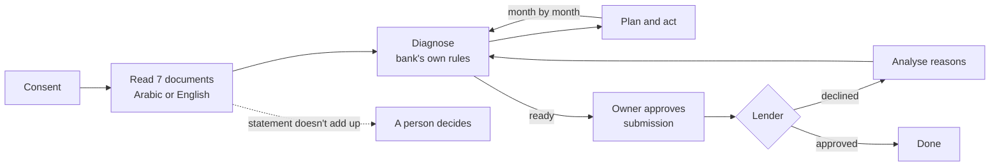
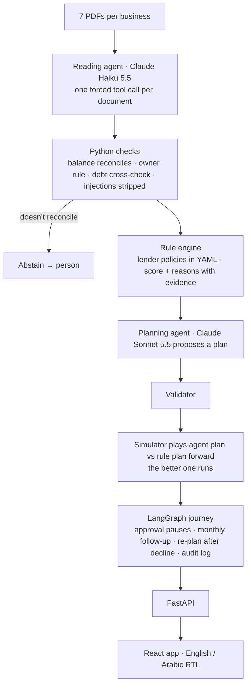

# NextYes

**Turn a bank's no into a next yes.** An AI agent that takes a small business from a declined loan application to an approval: it reads the paperwork, finds every reason for the no, fixes what it can itself, follows up on the rest, and applies again.

Built solo for the **HUMAIN Future AI Builders hackathon · Challenge 3: Autonomous Enterprise.**

| | |
|---|---|
| **Live app** | [next-yes.vercel.app](https://next-yes.vercel.app) (try it as a business, as a bank, or open the results) |
| **API** | [nextyes-api.onrender.com/docs](https://nextyes-api.onrender.com/docs) |
| **Headline result** | **97%** exact-match lending decisions on 20 held-out businesses, run once (37/38, Wilson 95% CI 86–99%) |
| **Tests** | 583 automated tests · every evaluation report in [`backend/reports/`](backend/reports) |

> A concept for the HUMAIN ONE agent marketplace. Not an official HUMAIN product. All businesses and documents are synthetic and marked SIMULATED.

---

## 1. The problem

Saudi Arabia wants small businesses to get far more bank credit: MSMEs held **9.4%** of bank credit in 2024 against a Vision 2030 target of **20%** (SAMA data, reported by Arab News, 1 Apr 2025).

Part of the gap is applications that get a "no" and no plan. The owner receives *"your application was not approved at this time"*. Behind it, the reasons are often fixable, for example in our demo business:

| What the bank saw | The fix |
|---|---|
| Repayment cover 0.71, policy needs 1.2 | Ask for SAR 1.45M, the amount the cash flow can repay |
| No collateral | Kafalah guarantee |
| Commercial registration expires in 30 days | Renew online |
| 44% of invoices overdue | Chase them |

The owner doesn't know which ones matter, and the bank loses a customer it could have served.

**Customer:** the bank (deploys NextYes from HUMAIN ONE). **User:** the SME owner. **Business model (idea only):** the bank pays per approved application or by subscription; the owner pays nothing.

## 2. What NextYes does



| Who | Does what |
|---|---|
| **The agent** | Reads and checks documents, fetches a missing one from its source, plans, chases overdue invoices, re-assesses, compiles the application |
| **The owner** | Consents, approves prepared steps, approves the final submission: about 3 clicks |
| **A person** | Takes over when a statement doesn't reconcile or no fix exists. The agent never guesses |

## 3. How it works

**AI where things are messy, rules where they must be exact.**



- **The model never approves a loan.** It reads and plans. A deterministic rule engine scores the business against the lender's policy, so a decision is explainable, repeatable and auditable.
- **The model reads; Python counts.** For the bank statement the model classifies every line; Python does the sums and checks the statement reconciles (opening + lines = closing).
- **Every agent plan is verified.** Sonnet proposes steps, amount and lender from a fixed menu of remedies. A validator rejects anything forbidden, uncovered or unaffordable (one retry with feedback), then a simulator plays both the agent's plan and the rule-based plan forward month by month, and the better one runs.
- **Owner in control.** LangGraph `interrupt()` pauses at consent, every approval and before anything reaches a lender. State is checkpointed in SQLite, so a journey survives restarts and spans simulated months.

**Stack:** Claude Haiku 5.5 (reading, chat screening) · Claude Sonnet 5.5 (planning, explanations) · LangGraph · Python, FastAPI, pdfplumber, pydantic · React, Vite, Tailwind · Render (API) + Vercel (web). Publicly available models and open-source tools; no HUMAIN models or credits were used.

## 4. Results (held-out set)

The 20 held-out businesses were never looked at during development, were run **once** at the end, and nothing was changed afterwards.

| Metric | Realistic | Hard |
|---|---|---|
| Field accuracy (16 figures per business) | 98.8% | 96.3% |
| Decision exact match (same verdict **and** same reasons) | 19 / 20 | 18 / 18 |
| Abstained → sent to a person | 0 | 2 |
| Missing documents detected exactly | 20 / 20 | 20 / 20 |
| Conflicting figures caught · false alarms | none planted · 1 | 33 / 33 · 1 |

- **97%** = 37 of 38 decided files; **coverage 95%** (38 of 40 decided, 2 abstained).
- **The one miss** (heldout-016): monthly revenue was misread, so one reason in the list differed.
- **Two lenders, same result:** the commercial bank and the digital invoice lender have different rules (YAML, no code change); 37/38 on each.

**Agent metrics (held-out):** 19/20 journeys reach the bank's threshold (the other has no fix within 12 months and the agent says so) · 0.95 owner actions per journey · 2/40 files escalated to a person · roughly 20–60 s and ~20–25k input / ~9–10k output tokens to read one business live (approximate).

**Development set (40 businesses, 3 levels):** 116/116 decisions exact, 4 abstained, planted prompt injections resisted 39/40.

Reports: [`extraction-heldout-realistic-haiku.md`](backend/reports/extraction-heldout-realistic-haiku.md) · [`extraction-heldout-hard-haiku.md`](backend/reports/extraction-heldout-hard-haiku.md) · [`planner-heldout-claude.md`](backend/reports/planner-heldout-claude.md). The app's [Results page](https://next-yes.vercel.app/results) is computed from these same files.

> **Read with care:** dev and held-out come from the same generator, so these are unseen *businesses*, not unseen *document styles*. Real bank paperwork will be harder.

## 5. How this maps to the judging criteria

| Criterion | Evidence | Where |
|---|---|---|
| **Task performance** | 97% exact-match decisions on held-out, run once; field accuracy 96–99% | §4, `backend/reports/extraction-heldout-*` |
| **Robustness & adaptation** | Same truth rendered at 3 difficulty levels (scans, Arabic-only lines, right-to-left statements, conflicts, prompt injections); 2 lenders with different rules, no code change; agent re-plans when the owner refuses a step or the lender declines; abstains instead of guessing | §4, §6, `backend/policies/`, `app/synth/variants.py` |
| **Evaluation & iteration** | Ground truth known for every business; held-out protocol; prompt versions v1 → v4 driven by error analysis; each fix locked in with regression tests (583) | §6 |
| **Technical judgment & creativity** | Model reads and plans, rules decide; agent plan must beat or match the rule plan in simulation; abstention; honest comparison with the simpler alternative | §3, §7 |
| **Engineering quality** | Typed state (pydantic), small modules, versioned prompts, answer cache, deployed app + API, CLI for every step | §8, [`docs/TECHNICAL.md`](docs/TECHNICAL.md) |
| **Communication** | Slides, video, this README, a live Results page | — |

## 6. Data, evaluation and iteration

**Why synthetic data:** real SME bank files are confidential, and without a known truth nothing can be scored.

1. **63 businesses** with known true financials: 40 development · 20 held-out · 3 demo. Each starts healthy, then issues are planted from a catalogue whose codes match the policy rule ids, so the right answer is known. Held-out uses different seeds, only issue combinations never seen in dev, and wording never used in dev (tested).
2. For each, a 12-month ledger is rendered into the **7 PDFs** a bank asks for: bank statement, CR certificate, credit report, tax compliance, receivables aging, financing application, income statement. A test proves the documents reproduce the true data exactly, so every measured error belongs to the agent.
3. **Three levels**, same numbers, different presentation:
   - *clean* — one layout, fixed wording.
   - *realistic* — 3 bank layouts incl. right-to-left Arabic, varied and Arabic-only wording, customers who look like the owner, ~30% missing a document.
   - *hard* — realistic + scanned pages, documents that contradict each other, and a hidden instruction aimed at the AI reader.
4. **Lender rules** from public sources ([Lendo](https://www.lendo.sa/en/blog/business-financing-requirements-in-saudi-arabia), [Qoyod](https://www.qoyod.com/en/reports/saudi-sme-financing-2026/)); thresholds we had to choose are marked `assumption: true`.

**Iteration, from error analysis on dev only** (`app/extract/diagnose.py`):

| Problem found | Change | Effect (dev, realistic) |
|---|---|---|
| Owner transfers counted as sales | Match the owner's name from the CR certificate | — |
| Money in and out swapped in right-to-left statements | Prompt v4 asks for the running balance; Python repairs direction from it | v3: 95% fields / 37 of 39 decisions → v4: 99% / 39 of 40 |
| Supplier payments in Arabic labelled "other" | v4 adds category examples from dev wording | (in the line above) |
| Lines missed on long statements | Re-read page by page when the statement doesn't reconcile | (in the line above) |
| One statement still didn't add up | Safety rule: no decision, a person takes over | Abstention instead of a wrong answer |
| Instructions hidden in documents | Stripped before the model, flagged to the bank, prompt treats documents as data | 39/40 resisted on dev hard |

Tuning stopped there on purpose to avoid fitting the dev set.

**Agent planner vs the simpler alternative (rule-based plan):**

| | Dev | Held-out |
|---|---|---|
| Owner approves everything: reaches threshold (rules · agent) | 40/40 · 40/40 | 19/20 · 19/20 |
| Owner actions per journey (rules → agent) | 1.23 → 0.88 | 1.25 → 0.95 |
| Owner refuses the first step asked: ready (rules · agent) | 27 · 28 of 40 | 12 · 11 of 20 |
| Agent plans valid at first try | 67 / 67 | 42 / 42 (109 / 109 in total) |

The benefit is modest and we report it as such: same success, about 25% fewer asks of the owner. When the owner refuses a step the result is a tie (+1 on dev, −1 on held-out): the agent finds another route when one exists (e.g. dev-029: Kafalah refused → switches to the digital lender), but it asks for fewer steps, so there is less to fall back on. Its value is that it adapts, explains its choice, and every plan it runs is verified.

## 7. Key design decisions and trade-offs

- **LLM reads, rules decide.** Banks need decisions they can explain and repeat. Cost: the agent can only fix what the remedy menu covers.
- **Abstain rather than guess.** A statement that doesn't reconcile gives no decision. Cost: 2 of 40 held-out files go to a person; benefit: no confident wrong answers from a misread statement.
- **Haiku for reading, Sonnet for planning.** Reading is routine and high-volume; planning and explaining need judgment.
- **Policies are data.** A new lender is a YAML file; the evaluation shows the same accuracy on both lenders.
- **Agent plan must earn its place.** It runs only if the simulator says it is at least as good as the rule plan.
- **Guardrails in the chat.** Every owner message is screened (rules, then Haiku); requests to hide a debt, inflate revenue or alter a document are refused with a lawful alternative and logged.

## 8. Run it

The live app needs nothing installed. To run locally (Python 3.10+, Node 18+). On Windows, run one line at a time in PowerShell.

```bash
cd backend
python -m venv .venv
.venv\Scripts\activate            # macOS/Linux: source .venv/bin/activate
pip install -e ".[dev]"
python -m pytest -q               # 583 tests, ~2 minutes
uvicorn app.api.main:app --reload # API at http://127.0.0.1:8000/docs
```

```bash
cd frontend
npm install
npm run dev                       # http://localhost:5173
```

**Without an API key** everything still runs: the API reads documents with the oracle reader (a perfect reader built from the ledger) and the chat uses templates. Add `ANTHROPIC_API_KEY=...` to `backend/.env` for the real models.

**Reproduce the numbers** (from `backend/`):

```bash
python -m app.synth.dataset                                              # 63 businesses (already committed)
python -m app.synth.documents                                            # render the PDFs (~3 min; dev and held-out PDFs are not committed)
python -m app.extract.evaluate --split heldout --level all --reader haiku # held-out extraction → reports/
python -m app.agent.evaluate_planner --split heldout                     # agent vs rule planner → reports/
python -m app.extract.evaluate --split dev --level all --reader oracle   # pipeline ceiling, no key needed
python -m app.agent.demo demo-bakery-supplier                            # watch one journey in the terminal
```

Model answers are cached in `backend/cache/` (key = model + prompt version + prompt + document). The demo businesses replay entirely from the cache; set any placeholder key (`ANTHROPIC_API_KEY=cache-only`) and no call is made. PDFs rendered on a different machine may not match the cache byte for byte, so a full dev or held-out re-run may call the model and needs a real key.

## 9. Repository map

```
backend/
  app/engine/    rule engine: finance maths, rules, YAML policy loader, assess()
  app/synth/     synthetic businesses, ledgers, bilingual PDFs, difficulty levels
  app/extract/   PDF text, Haiku reader + cache, injection stripping, assembly + checks, evaluation
  app/agent/     remedies, simulator, rule planner + validator, agent planner, LangGraph journey, brain
  app/api/       FastAPI
  policies/      commercial_bank_sme.yaml · digital_lender_invoice.yaml
  data/          businesses + truth (dev / heldout / demo)
  reports/       every evaluation report (.md + .json)
  tests/         583 tests
frontend/        React app: landing · business journey · bank credit desk · results
docs/            TECHNICAL.md (module and API reference) · journey_graph.mmd
```

## 10. Limitations and next steps

**Today:** synthetic businesses and documents from one generator · actions are simulated (registration renewal, Kafalah, reminders) and missing documents are "fetched" from a simulated source · some rule thresholds are our assumption (marked) · a small menu of fixes limits what planning can add · prompt-injection phrasings were written alongside the detector, so 39/40 is an optimistic figure · long reason texts are English only.

**Next:** real connections (SIMAH, Wathq, ZATCA, open banking) · test on real, anonymised bank files · more lenders and remedies, where planning matters more · individuals (mortgage, personal finance) · other products and GCC markets. Anywhere a financial decision says "no", the same loop can look for the way to "yes".

---

Ahmed Alluqmani · [next-yes.vercel.app](https://next-yes.vercel.app)
